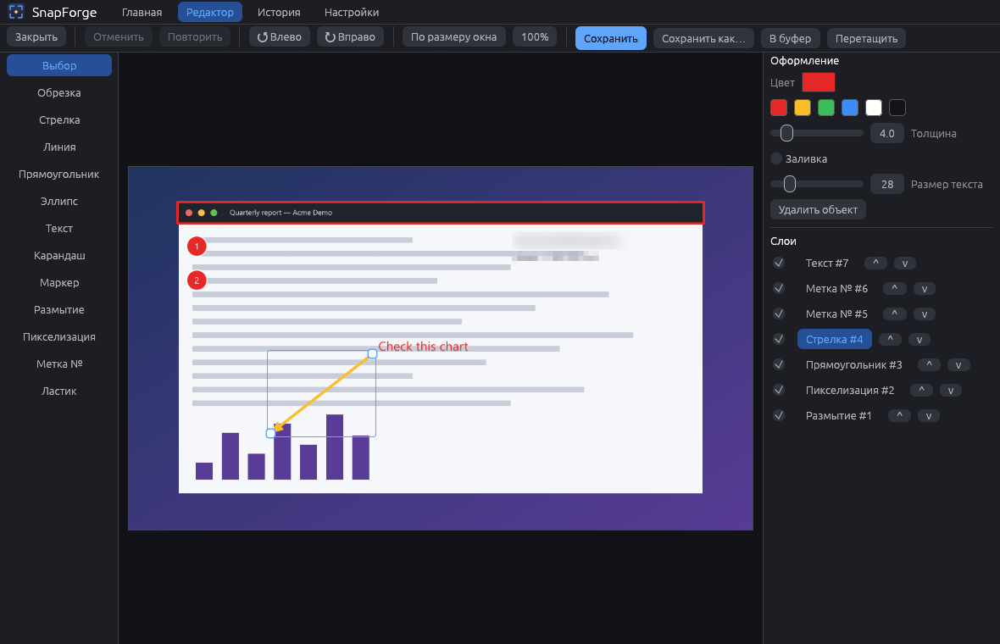
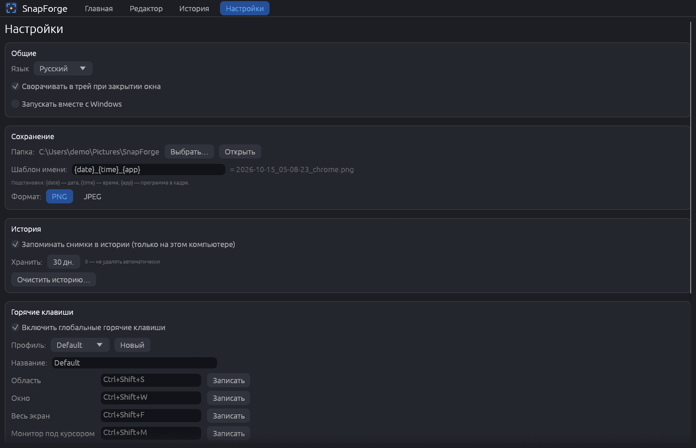

# SnapForge

[English](README.en.md) · [Русский](README.md)

Безопасная замена ShareX для Windows: захват экрана, редактор с векторными аннотациями, история снимков и
глобальные горячие клавиши. Всё хранится локально; в сеть программа ходит только за проверкой обновлений на GitHub.



*Все скриншоты сделаны на выдуманных данных (`SnapForge.exe --demo`) — настоящих окон, имён и людей на них нет.*

## Чем отличается от ShareX

- **Безопасность.** Никаких нативных DLL-плагинов и произвольного кода. (В 0.3.0 плагины появятся как скрипты на Rhai в
  песочнице с явными разрешениями; в 0.1.0 плагинов нет.)
- **Локально по умолчанию.** Никакой загрузки на серверы, телеметрии и «облака». Единственный сетевой запрос —
  проверка обновлений раз в сутки (отключается в настройках).
- **Объекты остаются векторными.** Стрелки, рамки, текст, метки, размытие можно двигать, менять и удалять до тех
  пор, пока вы не сохраните снимок.
- **Без прав администратора.** Установка и работа — в профиле пользователя.

## Возможности (0.1.0)

- **Захват:** область (замороженный кадр, лупа у курсора, выделение с точностью до пикселя, стрелки двигают
  курсор на 1 пиксель, Shift — на 10), окно, весь экран, отдельный монитор. Несколько мониторов с разным
  масштабом: все координаты — физические пиксели виртуального рабочего стола, область на стыке мониторов
  склеивается из кусков. Задержка, курсор в кадре — по выбору.
- **Как снимается:** Windows.Graphics.Capture, а если он недоступен или дал сбой — GDI.
- **Горячие клавиши:** глобальные (`RegisterHotKey`), настраиваются в программе, можно «записать» сочетание,
  дубликаты и занятые другими программами сочетания показываются сразу; несколько профилей. Значок в трее,
  автозапуск по желанию.
- **Редактор:** обрезка, поворот, стрелка, линия, прямоугольник и эллипс (с заливкой или без), текст, карандаш,
  маркер, размытие и пикселизация области, нумерованные метки, ластик, отмена и повтор, масштаб (Ctrl + колесо,
  панорамирование средней кнопкой), панель слоёв (порядок, скрыть/показать, удалить).
- **Вывод:** в папку по шаблону имени (`{date}_{time}_{app}`), в буфер обмена, «Сохранить как…» (PNG/JPEG),
  перетаскивание изображения из окна в проводник, чат и т. п.
- **История:** сетка миниатюр, поиск по программе, дате и размеру, удаление, открытие в редакторе. Срок хранения
  и кнопка «очистить историю».
- **Интерфейс:** русский по умолчанию, английский переключается в настройках.
- **`snapforge-cli`:** `capture --region X,Y,W,H | --screen | --monitor N | --window`, `monitors`, `history list|clear`.

| Главная | История |
| --- | --- |
|  |  |



## Установка

Скачайте `SnapForge-Setup.exe` со страницы [Releases](https://github.com/ahsoggg-creator/snapforge/releases/latest)
и запустите. Права администратора не нужны — программа ставится в `%LOCALAPPDATA%\Programs\SnapForge`,
добавляет ярлык в меню «Пуск» (по желанию — на рабочий стол) и запись в «Приложения и возможности».
Удаление — оттуда же или `SnapForge.exe --uninstall`.

Есть и переносная версия — просто `SnapForge.exe`; установить её можно позже из настроек.

Командные ключи `SnapForge.exe`:

| Ключ | Что делает |
| --- | --- |
| `--install` / `--uninstall` | окно установки / удаления (то же, что `SnapForge-Setup.exe`) |
| `--update` | проверить и установить обновление без окна |
| `--minimized` | запуститься в трей (так стартует автозапуск) |
| `--demo` | выдуманные данные: ничего реального не читается и не пишется |
| `--screenshots <папка>` | пересоздать скриншоты для README |

### Подпись кода и SmartScreen

Исполняемые файлы релизов **не подписаны**, поэтому SmartScreen может показать «Windows защитила ваш компьютер» /
«неизвестный издатель». Это нормально для проекта без платного сертификата; проверить файл можно по `SHA256SUMS.txt`
из релиза. В `scripts/` лежат необязательные скрипты для подписи самоподписанным сертификатом
(`make_cert.ps1`, `trust_cert.ps1`, `sign.ps1`, `release.ps1`) — закрытый ключ остаётся только на вашем компьютере,
файлы `*.pfx` исключены из git. Самоподписанный сертификат SmartScreen не убирает, пока вы сами не добавите его в
доверенные.

## Приватность и диагностика

- Снимки — личные данные: история хранится только в `%APPDATA%\SnapForge\history`. Срок хранения (по умолчанию
  30 дней) и «очистить историю» — в настройках.
- Единственный сетевой запрос — проверка новой версии (`api.github.com`), отключается в настройках. Телеметрии нет.
- Журнал: `%APPDATA%\SnapForge\logs\snapforge.log` (ротация 512 КБ). Отчёты о сбоях:
  `logs\crashes\crash-<время>.txt` (версия, место паники, стек, хвост журнала). В журнал и отчёты не попадает
  содержимое снимков; токены и ключи, если они появятся в тексте, вырезаются.
- Настройки → «Диагностика»: открыть папку журналов или скопировать диагностический текст.

## Сборка

```powershell
cargo build --release          # SnapForge.exe и snapforge-cli.exe в target\release
cargo test --workspace         # юнит-тесты
cargo test --workspace -- --ignored --test-threads=1   # тесты, которым нужен настоящий рабочий стол
cargo clippy --workspace --all-targets -- -D warnings
```

Нужен Rust stable (edition 2024) и Windows с MSVC. Полный набор файлов релиза: `scripts\release.ps1`.

## Структура проекта

```
crates/core   вся логика без интерфейса: захват, геометрия мониторов, редактор, история, настройки, горячие клавиши
crates/app    GUI на egui + установщик, автообновление, трей, диагностика, демо-режим
crates/cli    snapforge-cli
scripts/      сборка и релиз, самоподписанный сертификат, иконка
docs/         скриншоты, заметки релизов
```

## Лицензия

На ваш выбор [MIT](LICENSE-MIT) или [Apache-2.0](LICENSE-APACHE).
