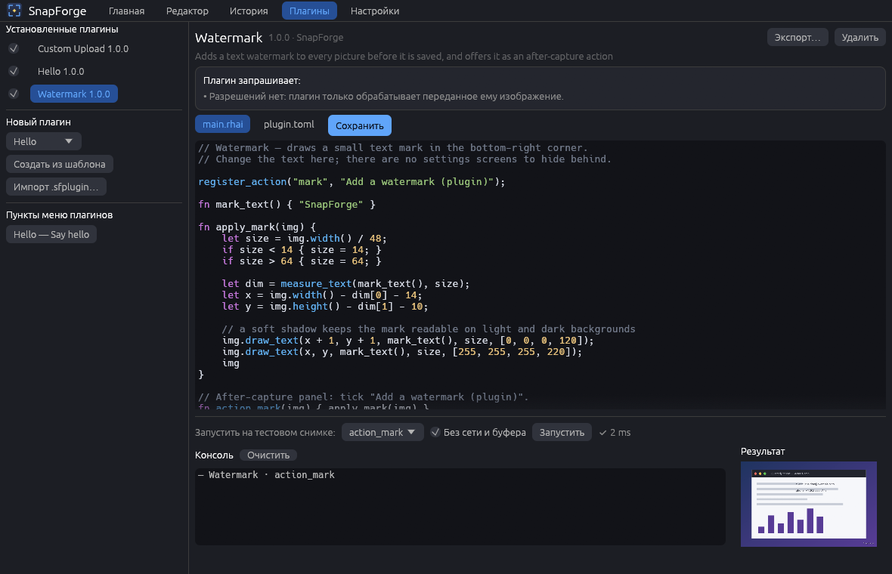
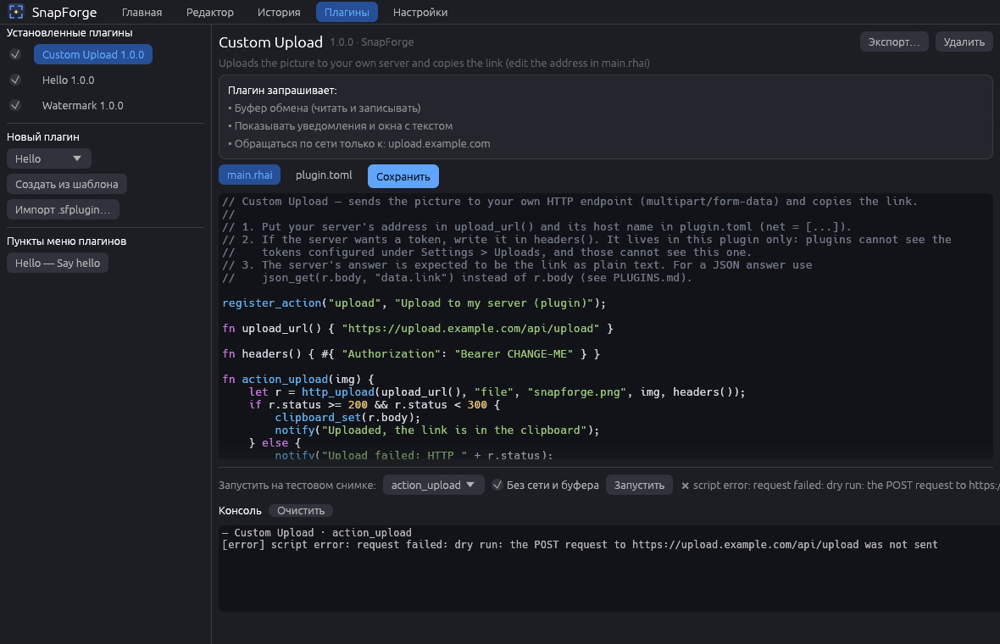
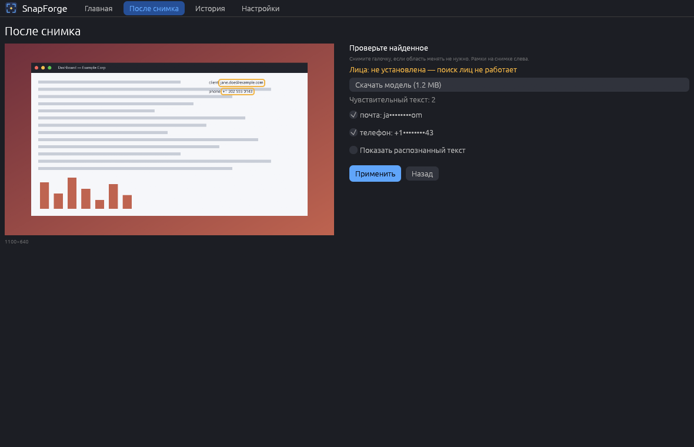
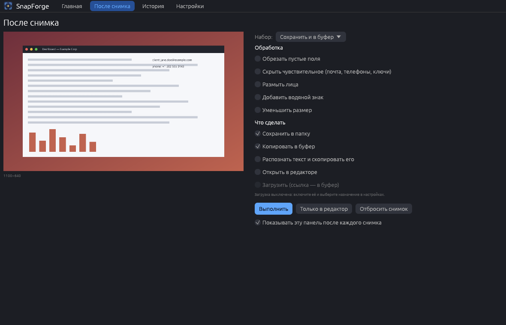
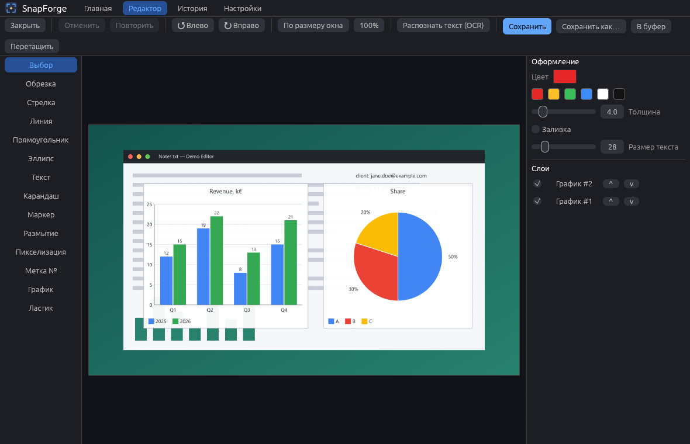
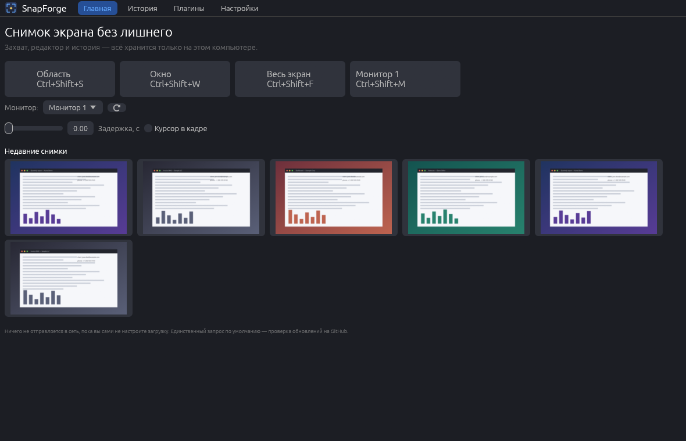
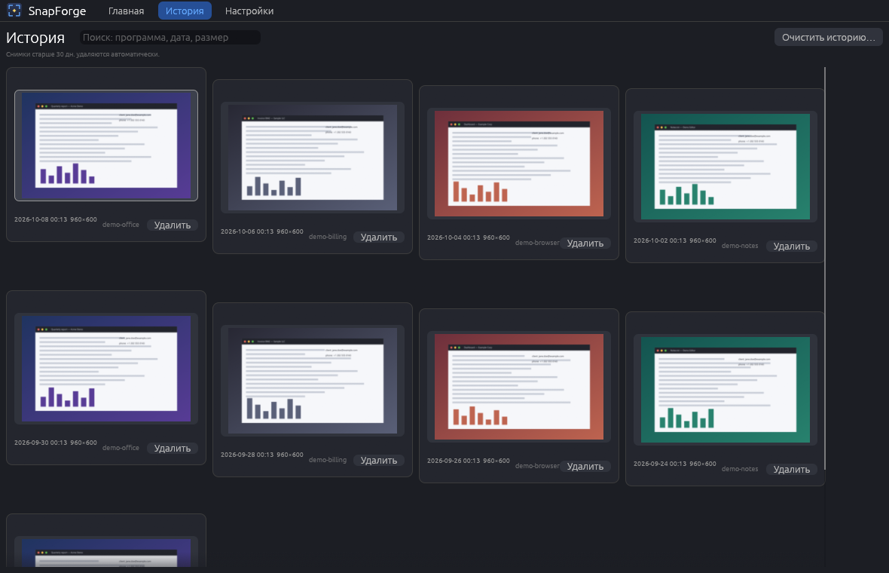
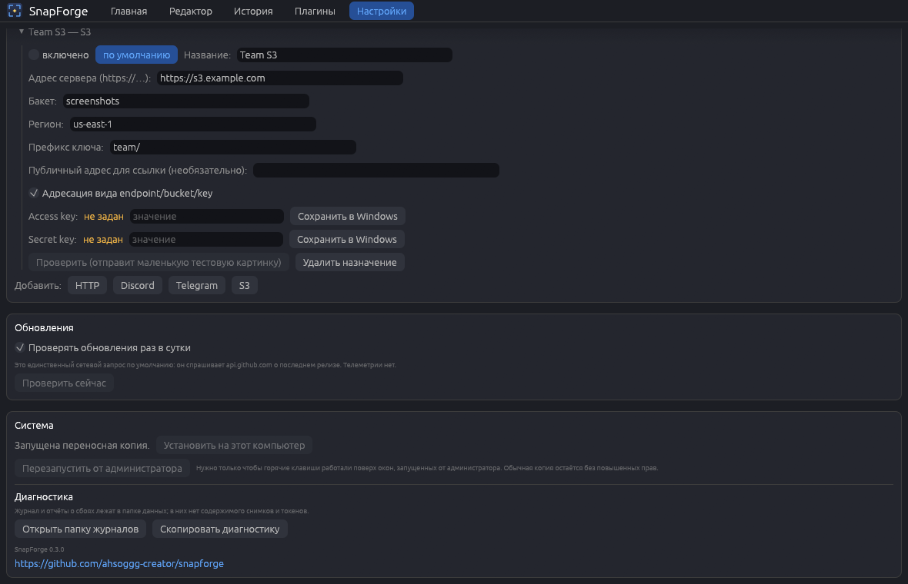

# SnapForge

[English](README.en.md) · [Русский](README.md)

Безопасная замена ShareX для Windows: захват экрана, редактор с векторными аннотациями, история снимков и
глобальные горячие клавиши. Всё хранится локально; в сеть программа ходит только за проверкой обновлений на GitHub.



*Все скриншоты сделаны на выдуманных данных (`SnapForge.exe --demo`) — настоящих окон, имён и людей на них нет.*

## Чем отличается от ShareX

- **Безопасность.** Никаких нативных DLL-плагинов и произвольного кода: плагины — скрипты на Rhai в песочнице, которые
  могут только то, что вы им явно разрешили (файлы только в указанных папках, сеть только к указанным доменам,
  буфер обмена, интерфейс), с лимитами на время, операции и память.
- **Локально по умолчанию.** Загрузка выключена, пока вы сами её не включите и не настроите; телеметрии и «облака»
  нет. Единственный сетевой запрос по умолчанию — проверка обновлений раз в сутки (отключается в настройках).
- **Объекты остаются векторными.** Стрелки, рамки, текст, метки, размытие можно двигать, менять и удалять до тех
  пор, пока вы не сохраните снимок.
- **Без прав администратора.** Установка и работа — в профиле пользователя.

## Возможности (0.4.0)

- **Оверлей съёмки (0.4.0).** Панель сверху, как в ShareX: режимы «область», «окно», «монитор под курсором» и «текст из области (OCR) сразу в буфер»; инструменты рамка, эллипс, линия, стрелка, карандаш, маркер, текст, метка с номером, размытие, пикселизация; цвет, толщина, отмена и «скрыть чувствительное после снимка». Нарисованное попадает в редактор отдельными редактируемыми объектами. Клавиши инструментов настраиваются (проверка повторов и зарезервированных), глобальные хоткеи можно «записать» любой клавишей, включая PrintScreen и Win, они применяются сразу; есть «Вернуть по умолчанию».
- **Захват:** область (замороженный кадр, лупа у курсора, выделение с точностью до пикселя, стрелки двигают
  курсор на 1 пиксель, Shift — на 10), окно, весь экран, отдельный монитор. Несколько мониторов с разным
  масштабом: все координаты — физические пиксели виртуального рабочего стола, область на стыке мониторов
  склеивается из кусков. Задержка, курсор в кадре — по выбору.
- **Как снимается:** Windows.Graphics.Capture, а если он недоступен или дал сбой — GDI.
- **Горячие клавиши:** глобальные (`RegisterHotKey`), настраиваются в программе, можно «записать» сочетание,
  дубликаты и занятые другими программами сочетания показываются сразу; несколько профилей. Значок в трее,
  автозапуск по желанию.
- **Редактор:** обрезка, поворот, стрелка, линия, прямоугольник и эллипс (с заливкой или без), текст, карандаш,
  маркер, размытие и пикселизация области, нумерованные метки, ластик, отмена и повтор, масштаб (Ctrl + колесо,
  панорамирование средней кнопкой), панель слоёв (порядок, скрыть/показать, удалить).
- **Вывод:** в папку по шаблону имени (`{date}_{time}_{app}`), в буфер обмена, «Сохранить как…» (PNG/JPEG),
  перетаскивание изображения из окна в проводник, чат и т. п.
- **История:** сетка миниатюр, поиск по программе, дате и размеру, удаление, открытие в редакторе. Срок хранения
  и кнопка «очистить историю».
- **После снимка (0.2.0).** Панель с галочками, которую можно настроить прямо в момент съёмки; наборы действий
  сохраняются. Что можно включить: сохранить, в буфер, открыть в редакторе, загрузить, размыть лица, распознать
  текст и скопировать его, скрыть чувствительное (почта, телефоны, ключи и токены, найденные OCR), обрезать пустые
  поля, добавить водяной знак (текст или PNG), уменьшить размер. Каждое действие отключается; по умолчанию ничего,
  кроме «открыть в редакторе», не включено, а загрузка недоступна, пока не включена в настройках.
- **Проверка перед применением.** Найденные лица и фрагменты текста рисуются рамками на снимке, и любую область
  можно снять галочкой до того, как она будет закрыта.
- **Лица и OCR — только оффлайн.** OCR идёт через `Windows.Media.Ocr` на установленных в Windows языках; поиск лиц —
  небольшая ONNX-модель, выполняемая на этом компьютере (`tract`). Модель **не вшита в программу**: её скачивают по
  кнопке (≈1,2 МБ), хеш SHA-256 проверяется, а без неё функция честно пишет «модель не установлена».
- **Графики (0.2.0).** Инструмент «График»: столбчатая, линейная и круговая диаграммы из таблицы, введённой в окне
  или вставленной из буфера (CSV/TSV, десятичная запятая и точка). Диаграмма — обычный редактируемый объект: можно
  двигать, менять размер, цвета, подписи и данные.
- **Загрузка (0.2.0, выключена по умолчанию).** Свой HTTP-аплоадер (URL, метод, заголовки, поле файла, путь к
  ссылке в JSON-ответе), webhook Discord, бот Telegram, S3-совместимое хранилище (подпись AWS SigV4). Токены и ключи
  хранятся **только в Диспетчере учётных данных Windows**, а не в файлах настроек, и вырезаются из журнала и отчётов о
  сбое. Ссылка после загрузки копируется в буфер.
- **Плагины (0.3.0).** Скрипты Rhai: хуки `on_capture`, `on_before_save`, `on_after_save`, действия в панели «после
  снимка», пункты меню и инструменты редактора; операции над изображением (размытие, пикселизация, обрезка, текст,
  наложение, пиксели, измерение), OCR, буфер обмена, уведомления — всё через разрешения. Плагин — папка или архив
  `.sfplugin` с `plugin.toml` (имя, версия, автор, описание, запрашиваемые разрешения) и скриптом. Встроенный редактор:
  список плагинов, код с подсветкой, шаблоны («Hello», «Водяной знак», «Загрузка на свой сервер»), пробный запуск на
  тестовом снимке с консолью ошибок, включение/выключение, экспорт и импорт `.sfplugin`. При установке показывается,
  что именно плагин просит; если разрешения изменились — плагин останавливается до нового подтверждения. Плагин не
  может прочитать токены загрузки. Подробности и примеры — в [docs/PLUGINS.md](docs/PLUGINS.md); три готовых плагина —
  в папке [`plugins/`](plugins).
- **Интерфейс:** русский по умолчанию, английский переключается в настройках.
- **`snapforge-cli`:** `capture --region X,Y,W,H | --screen | --monitor N | --window`, `monitors`, `ocr <файл>`,
  `plugin list`, `plugin run <плагин> --image файл --hook имя`, `history list|clear`.

| Плагин с разрешениями и пробный запуск | Панель «после снимка» |
| --- | --- |
|  |  |

| Панель «после снимка» | Графики в редакторе |
| --- | --- |
|  |  |

| Главная | История |
| --- | --- |
|  |  |



## Установка

Скачайте `SnapForge-Setup.exe` со страницы [Releases](https://github.com/ahsoggg-creator/snapforge/releases/latest)
и запустите. Права администратора не нужны — программа ставится в `%LOCALAPPDATA%\Programs\SnapForge`,
добавляет ярлык в меню «Пуск» (по желанию — на рабочий стол) и запись в «Приложения и возможности».
Удаление — оттуда же или `SnapForge.exe --uninstall`.

Есть и переносная версия — просто `SnapForge.exe`; установить её можно позже из настроек.

Командные ключи `SnapForge.exe`:

| Ключ | Что делает |
| --- | --- |
| `--install` / `--uninstall` | окно установки / удаления (то же, что `SnapForge-Setup.exe`) |
| `--update` | проверить и установить обновление без окна |
| `--minimized` | запуститься в трей (так стартует автозапуск) |
| `--demo` | выдуманные данные: ничего реального не читается и не пишется |
| `--screenshots <папка>` | пересоздать скриншоты для README |

### Подпись кода и SmartScreen

Исполняемые файлы релизов **не подписаны**, поэтому SmartScreen может показать «Windows защитила ваш компьютер» /
«неизвестный издатель». Это нормально для проекта без платного сертификата; проверить файл можно по `SHA256SUMS.txt`
из релиза. В `scripts/` лежат необязательные скрипты для подписи самоподписанным сертификатом
(`make_cert.ps1`, `trust_cert.ps1`, `sign.ps1`, `release.ps1`) — закрытый ключ остаётся только на вашем компьютере,
файлы `*.pfx` исключены из git. Самоподписанный сертификат SmartScreen не убирает, пока вы сами не добавите его в
доверенные.

## Приватность и диагностика

- Снимки — личные данные: история хранится только в `%APPDATA%\SnapForge\history`. Срок хранения (по умолчанию
  30 дней) и «очистить историю» — в настройках.
- Единственный сетевой запрос по умолчанию — проверка новой версии (`api.github.com`), отключается в настройках.
  Загрузка снимков выключена, пока вы не включите её и не включите конкретное назначение; скачивание модели лиц —
  только по вашей кнопке. Телеметрии нет.
- Журнал: `%APPDATA%\SnapForge\logs\snapforge.log` (ротация 512 КБ). Отчёты о сбоях:
  `logs\crashes\crash-<время>.txt` (версия, место паники, стек, хвост журнала). В журнал и отчёты не попадает
  содержимое снимков; токены и ключи, если они появятся в тексте, вырезаются.
- Настройки → «Диагностика»: открыть папку журналов или скопировать диагностический текст.

## Сборка

```powershell
cargo build --release          # SnapForge.exe и snapforge-cli.exe в target\release
cargo test --workspace         # юнит-тесты
cargo test --workspace -- --ignored --test-threads=1   # тесты, которым нужен настоящий рабочий стол
cargo clippy --workspace --all-targets -- -D warnings
```

Нужен Rust stable (edition 2024) и Windows с MSVC. Полный набор файлов релиза: `scripts\release.ps1`.

## Структура проекта

```
crates/core   вся логика без интерфейса: захват, геометрия мониторов, редактор, история, настройки, горячие клавиши
crates/app    GUI на egui + установщик, автообновление, трей, диагностика, демо-режим
crates/cli    snapforge-cli
plugins/      три готовых плагина (Hello, Watermark, Custom Upload)
scripts/      сборка и релиз, самоподписанный сертификат, иконка
docs/         PLUGINS.md, скриншоты, заметки релизов
```

## Лицензия

На ваш выбор [MIT](LICENSE-MIT) или [Apache-2.0](LICENSE-APACHE).
